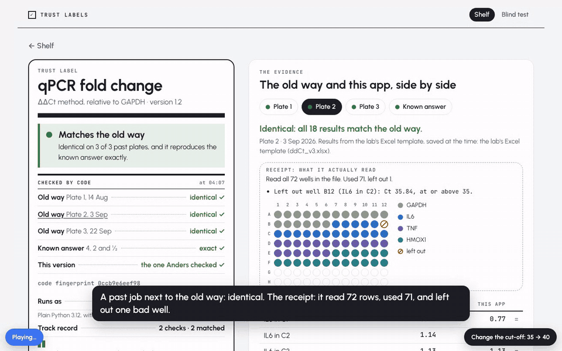

# Trust labels

**Sharing AI tools inside a company is easy. Trusting a colleague's tool is the hard part.**

Teams now build their own scripts, pipelines and AI-made apps, and they want to share the ones that work. The colleague who receives one has no way to tell a tool that works from one that only looks like it does, short of reading the code. Most people never will.

A trust label fixes that. Every shared tool carries a label that says **who checked it, against what, on which data, and until when**. Every line that can be checked is checked by code, every time the tool runs. A badge is not evidence; the label is.

## The idea: your old work is the answer key

Ask people how they know a pipeline works and they can't say. But everyone has past work they trusted: last quarter's report, the lab's Excel template, the legacy Stata do-file. So before a tool goes on the shared shelf, it is re-run on a few of those past jobs and compared, decimal by decimal, with what the old way produced. Where there is no old way, a tiny dataset with a known answer stands in.

Change one setting and the label turns amber within seconds and says why:

> **Differs from the old way.** Differs on Plate 2: 6 of 18 results changed.
> Since Anders checked it: the failed-well cut-off went from 35 to 40.



*`standalone.html` replaying the checker's real results. Names and plates are demo data.*

## Where it fits

- **Research groups and labs:** shared analysis pipelines, where a wrong number is expensive and hard to spot.
- **Analytics and finance teams:** automated reports that replace a manual process, where the manual output is the answer key.
- **Any internal "app store" for AI-made tools:** the label is a JSON file the platform attaches to each tool, and its store card shows three fields from it.

It borrows from fields that already solved trust in shared work: model risk management (SR 11-7), nf-core's test datasets for bioinformatics pipelines, and the AEA's replication standard in economics.

## Run it

Python 3.12, standard library only, nothing to install. In PowerShell:

```powershell
python trust.py serve
```

Open http://127.0.0.1:8765. To see the amber moment, open `skills\qpcr-ddct\skill.json`, change `"failed_well_ct": 35` to `40` and save. `python trust.py check` re-runs every check once and exits non-zero if any shelved tool isn't green.

## The label, field by field

| Field | Why it's there | Borrowed from |
|---|---|---|
| **Status**, green or amber, plus one sentence | One glance, and the sentence says exactly what differs ("Differs on Plate 2: 6 of 18 results changed") | Nutrition label top line; SR 11-7 ongoing monitoring |
| **Against the old way** | Re-runs the tool on real past jobs and compares with what the old process produced, to the decimals it reports | Legacy reconciliation; AEA replication packages |
| **Against a known answer** | A tiny dataset built so the right answer is known before anything runs (here 4, 2 and ½) | nf-core's required test dataset; known-answer tests |
| **On which data** | Each past job is named, dated and fingerprinted, so "it matched" points at specific files | Data checksums (AEA, nf-core) |
| **This version** | A code fingerprint, and whether it's the exact version the checker signed | nf-core versioned releases; pinned environments |
| **Runs as** | Read from the code itself: plain code, no AI, no internet when it runs | Pinned environments |
| **Checked by** | A named person in your field who is not the author | SR 11-7 independent validation and effective challenge |
| **Best before** | The check date plus 30 days, then a person looks again | Half-Life: the median life of an AI instruction is about 30 days |
| **Stated by the author** | What it does in plain steps, and who did each step: AI drafted, a person, or no AI. Marked "not checked" | Who presses send |
| **Problems reported** | Two different people reporting the same problem pauses the tool | Two Strikes |

Every result also carries a **stamp** (version, fingerprint, when it last matched, who checked it) and a **receipt** counted by code: how many rows it read, how many it used, and which it left out and why ("Read all 72 wells. Used 71, left out 1: well B12, Ct 35.84").

## Worked examples

- **`skills/qpcr-ddct/`**: qPCR fold change (ΔΔCt), checked against the lab's Excel template on three past plates and a known-answer plate.
- **`skills/did-cebi/`**: a difference-in-differences estimate, checked against a legacy Stata do-file on three past reports and a known-answer panel.
- **`skills/blind-a/`, `skills/blind-b/`**: two versions of the qPCR tool for a blind test. One silently skips the failed-well filter. Someone who wrote neither picks which to run using only the labels.

## Files

- `trust.py`: the checker and local server. It re-runs a tool whenever its code, settings or evidence change, and writes `label.json` next to it. `sign` records a checker's sign-off.
- `label.html`: the shelf, the label, the old-versus-new view, "use it on my data" and the blind test.
- `build_standalone.py` → `standalone.html`: bakes the label page and the checker's real results into one file that runs anywhere and plays itself.
- `story.html`: a self-playing walkthrough, from a tool being shared to its label going amber and back.
- `demo-data/`: builds the demo evidence.
- `DEMO.md`, `WORDING.md`: the original two-minute demo script and the frozen label wording.
- `INVENTORY.md`: where every related piece lives (prototypes, decks, the earlier research).

## Plugging it into a platform

Attach `skills/<tool>/label.json` to each tool. A store card needs three fields: `made_by.name`, `summary` ("Matches the old way on 3 of 3 past plates") and `best_before`, coloured by `status` (`verified` is green; `differs`, `changed`, `expired` and `paused` are amber). The rest is the full label. To shelve a new tool, add a folder with `skill.py` (a `run(rows, settings)` function), `skill.json` and `evidence/<job>/{input.csv, expected.csv, job.json}`, then sign it:

```powershell
python trust.py sign qpcr-ddct "Dr Anders Kjær" "qPCR core facility"
```

## Honest notes

- **Demo data.** The "old way" outputs come from stand-ins that copy the Excel template's and the do-file's formulas, because Excel and Stata can't run here. A real deployment replaces each `expected.csv` with a real export. The known-answer datasets need no stand-in: their answers are fixed by construction.
- **Names are fictional.** Sofie Lund, Anders Kjær and Jonas Holm are placeholders.
- **Exact match** means equal at the precision the old way reports (2 decimals here). Plain code gives the same answer every time, so no tolerance is needed. Anything with AI at run time would need one.

## Origin

Built by Ben Smart at the Claude Impact Lab, CodeNode Copenhagen, 21 October 2026, as the trust layer for a team building an internal app store for AI-made tools.
